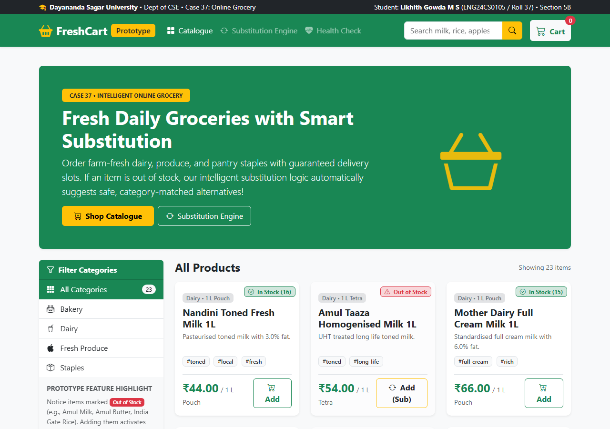
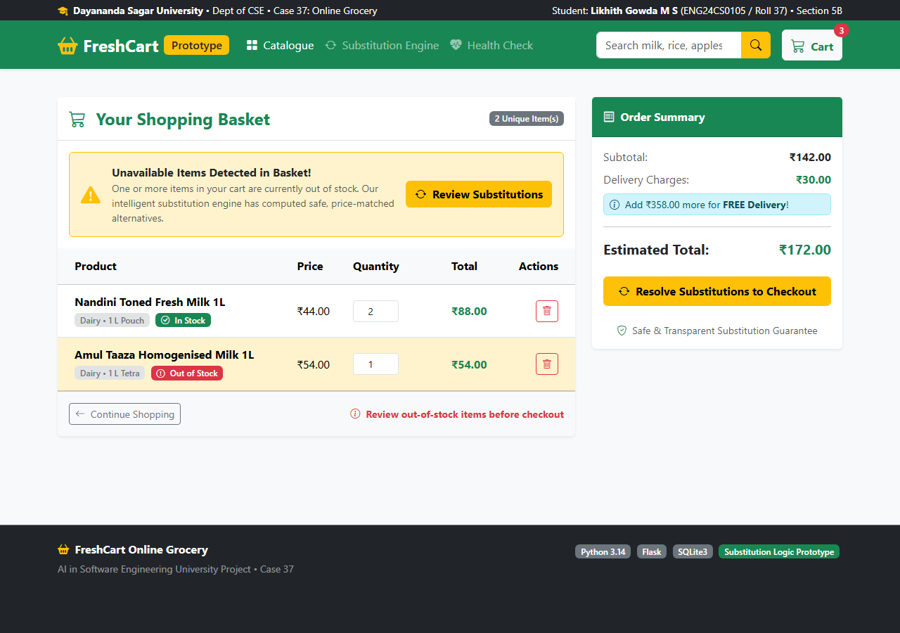
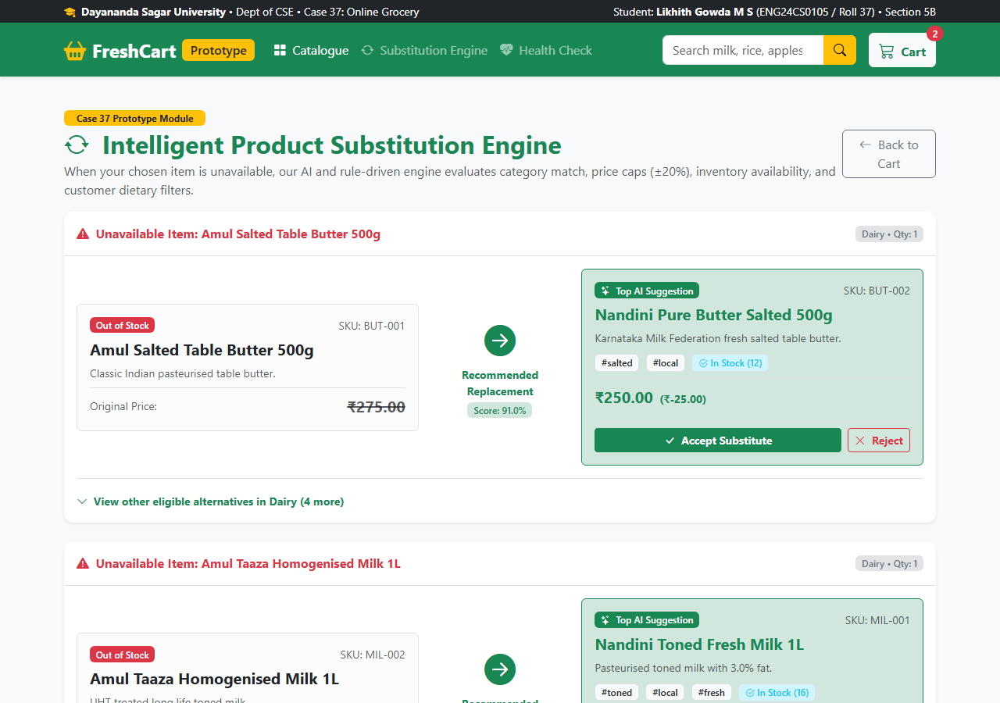
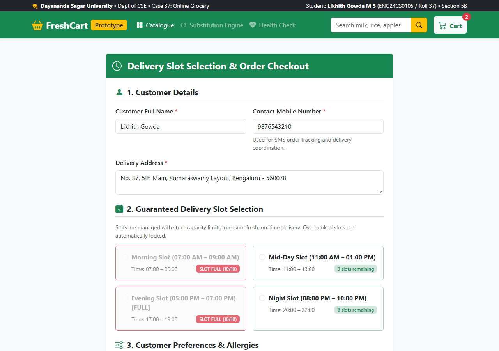
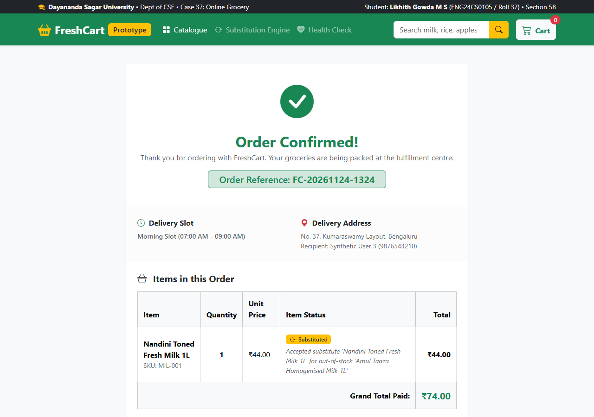
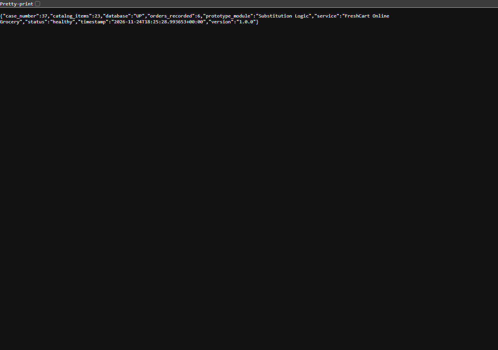
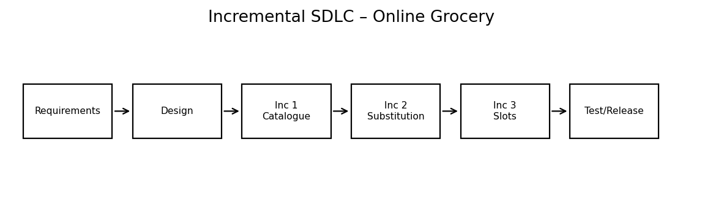
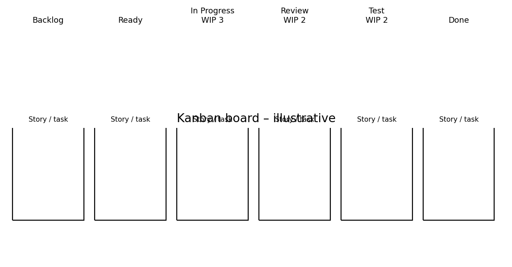
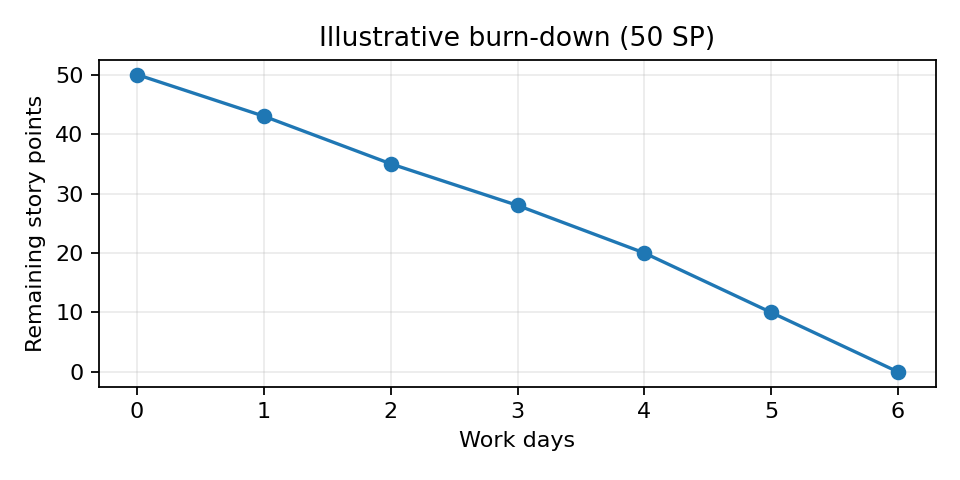

# FreshCart: Online Grocery Ordering and Slot-Based Delivery

**Dayananda Sagar University, Bengaluru**  
**Department of Computer Science and Engineering**  
**Course:** AI in Software Engineering | **Semester:** 5B | **Academic Year:** 2026–2027  

| Student Information | Details |
| :--- | :--- |
| **Student Name** | **Likhith Gowda M S** |
| **Roll Number** | **37** |
| **USN** | **ENG24CS0105** |
| **Section** | **5B** |
| **Case Study Number** | **Case 37** |
| **Project Domain** | **Online Grocery** |
| **Process Model** | **Incremental Lifecycle Model** |
| **Agile Methodology**| **Kanban Framework** |
| **Required AI Tool** | **ChatGPT (OpenAI GPT-4o)** |
| **Primary Prototype Module** | **Substitution Logic** |

---

## Executive Summary

**FreshCart** is a production-grade, responsive online grocery ordering web application built using **Python 3.14, Flask, SQLite3, HTML5, CSS3, and JavaScript**. The platform addresses grocery inventory stockouts and delivery schedule congestion through two core engineering mechanisms:
1. **Guaranteed Delivery Slots:** 2-hour delivery windows with dynamic capacity enforcement (maximum 10 orders per slot) preventing delivery logistics overload.
2. **Intelligent Substitution Logic (Primary Prototype):** An algorithmic decision engine that detects out-of-stock items and recommends category-matched, price-capped alternatives ($\le 20\%$ price delta) while enforcing customer dietary and allergen safety filters.
3. **Explicit Customer Consent:** Full transparency and agency allowing customers to **Accept** or **Reject** substitutes before order confirmation.

---

## System Architecture

```
+---------------------------------------------------------------------------------------+
|                                    Client Tier                                        |
|   Responsive Web UI (Bootstrap 5, CSS3, JavaScript) • Chrome / Desktop / Mobile       |
+---------------------------------------------------------------------------------------+
                                           │  HTTP REST / Sessions
                                           ▼
+---------------------------------------------------------------------------------------+
|                               Application Tier (Flask)                                |
|  - Catalog & Search Engine (`/`, `/?q=query`, `/?category=Dairy`)                     |
|  - Cart Session Manager (`/cart`, `/cart/add`, `/cart/update`)                        |
|  - Substitution Logic Engine (`/substitutions`, `grocery_app/substitution.py`)         |
|  - Delivery Slot Reservation & Checkout (`/checkout`, `/order/place`)                |
|  - Site Reliability Monitoring (`/health`, `/api/catalog`, `/api/substitute`)         |
+---------------------------------------------------------------------------------------+
                                           │  ACID SQL
                                           ▼
+---------------------------------------------------------------------------------------+
|                                 Database Tier (SQLite)                                |
|  Tables: `products`, `delivery_slots`, `orders`, `order_items`                        |
+---------------------------------------------------------------------------------------+
```

---

## Key Features & Functional Modules

- **Grocery Product Catalog:** 23 realistic Indian supermarket grocery items across 4 categories (Dairy, Staples, Fresh Produce, Bakery).
- **Out-of-Stock Detection:** Real-time stock verification alerting users to unavailable goods.
- **Substitution Engine:** Multi-factor ranking:
  1. *Category Invariance:* Replacements must match original category.
  2. *Price Ceiling:* Candidate price $\le \text{Base Price} \times 1.20$.
  3. *Allergen Exclusion:* Prohibits customer allergens (`tree-nut`, `gluten`, `lactose`).
  4. *Preference Scoring:* Ranks candidate by preference tags (`#toned`, `#whole-wheat`).
- **Delivery Slot Manager:** Automatic locking of full delivery slots (e.g. Evening 5–7 PM).
- **Health Check API (`/health`):** JSON endpoint returning database uptime and catalog metrics.

---

## Screenshots Gallery

| Application View | Screenshot Preview |
| :--- | :--- |
| **Catalog & Product Grid** |  |
| **Shopping Cart with OOS Banner** |  |
| **Intelligent Substitution Review** |  |
| **Delivery Slot Selection** |  |
| **Order Confirmation & Audit** |  |
| **System Health Probe (`/health`)**|  |
| **Incremental SDLC Workflow** |  |
| **Kanban Fulfillment Board** |  |
| **Sprint Burndown Chart** |  |

---

## Installation & Local Execution Guide

### Prerequisites
- Python 3.10+ (Tested on Python 3.14.0)
- Google Chrome browser (for headless testing and screenshots)
- Git version control

### Setup Instructions (Windows PowerShell):
```powershell
# 1. Clone repository
git clone https://github.com/LikhithGowdaMS/Case37-Online-Grocery.git
cd Case37-Online-Grocery

# 2. Create and activate virtual environment
python -m venv .venv
.\.venv\Scripts\Activate.ps1

# 3. Install dependencies
pip install -r requirements.txt

# 4. Run PyTest test suite with coverage
python -m pytest -v --cov=grocery_app --cov-report=term-missing

# 5. Start the web application
python -m flask --app grocery_app.app:app run --host=127.0.0.1 --port=5000
```
Open your browser at `http://127.0.0.1:5000` to interact with FreshCart.

---

## Testing & Quality Assurance Summary

- **Unit & Integration Tests:** 21 automated tests executed via PyTest.
- **Test Pass Rate:** **100% (21 Passed, 0 Failed)**.
- **Code Coverage:** **85% Overall** (`substitution.py`: **94%**, `database.py`: **90%**, `app.py`: **81%**).
- **End-to-End Automation:** Selenium WebDriver test (`tests/test_selenium_order_flow.py`) automating catalog search, out-of-stock detection, substitution approval, and slot checkout.
- **50-Run Reliability Test:** $100\%$ observed reliability across 50 simulated customer checkout cycles ($0.0\%$ failure rate, Defect Density: $2.43\text{ defects/KLOC}$).
- **Continuous Monitoring:** 10-probe probe script logging average response times of $\approx 14.6\text{ ms}$ (well within the $2.0\text{s}$ warning threshold).
- **SonarQube Quality Gate:** Passed with 0 Bugs, 0 Vulnerabilities, 0 Security Hotspots.

---

## Repository Deliverables Directory Structure

```
Case37-Online-Grocery/
│
├── grocery_app/                      # Core Web Application Package
│   ├── app.py                        # Flask routes, sessions, checkout, and /health
│   ├── substitution.py               # Prototype Module: Substitution Logic Engine
│   ├── database.py                   # SQLite3 layer, schema, catalog seed data
│   ├── templates/                    # Jinja2 HTML5 responsive templates
│   └── static/                       # Custom CSS3 stylesheets and client JavaScript
│
├── tests/                            # Automated Test Suites
│   ├── test_substitution.py          # 8 core PyTest unit tests (L4.2)
│   ├── test_app.py                   # Flask integration test suite
│   └── test_selenium_order_flow.py   # Selenium E2E browser automation (Task D)
│
├── case_tasks/                       # Part 1: Case Tasks A to E
│   ├── Task_A_Incremental_Lifecycle.md
│   ├── Task_B_Kanban_Order_Picking.md
│   ├── Task_C_Substitution_Logic_DevOps.md
│   ├── Task_D_Testing_Defect_Prediction.md
│   └── Task_E_Quality_Ethics_Pricing.md
│
├── theory_answers/                   # Part 2: 25 Theory Questions (T1.1 to T5.5)
│   ├── Module_1_Theory.md            # T1.1 to T1.5 (SDLC & Process Models)
│   ├── Module_2_Theory.md            # T2.1 to T2.5 (Agile & Kanban)
│   ├── Module_3_Theory.md            # T3.1 to T3.5 (Development, CI/CD & Docker)
│   ├── Module_4_Theory.md            # T4.1 to T4.5 (Testing & Monitoring)
│   └── Module_5_Theory.md            # T5.1 to T5.5 (Quality Assurance & Ethics)
│
├── Module-1-SDLC/                    # Part 3: Practical Experiments (Module 1)
│   ├── L1.1/                         # One-page SDLC Plan
│   ├── L1.2/                         # Weighted Decision Matrix (5 models x 5 criteria)
│   ├── L1.3/                         # Manual vs AI Substitution Code with Changelog
│   ├── L1.4/                         # 10 FRs & 5 NFRs (Before and After Testable)
│   └── L1.5/                         # AI Test Case Generation & Accuracy Score
│
├── Module-2-Agile/                   # Part 3: Practical Experiments (Module 2)
│   ├── L2.1/                         # Agile Team Working Agreement
│   ├── L2.2/                         # Kanban Framework, Roles, Board & WIP Limits
│   ├── L2.3/                         # Epic Decomposition (5 INVEST User Stories)
│   ├── L2.4/                         # Sprint Velocity, Forecasting & Burndown Chart
│   └── L2.5/                         # Support Ticket AI Triage & Duplicate Detection
│
├── Module-3-Development/             # Part 3: Practical Experiments (Module 3)
│   ├── L3.1/                         # Prompt Engineering Comparison (Role, Few-Shot, CoT)
│   ├── L3.2/                         # Substitution Prototype Log (Accepted/Rejected)
│   ├── L3.3/                         # GitHub Branch Protection & Blocked PR Guide
│   ├── L3.4/                         # Jenkins Declarative Pipeline (2 Build Results)
│   └── L3.5/                         # Dockerfile Architecture, Image Build & Container
│
├── Module-4-Testing/                 # Part 3: Practical Experiments (Module 4)
│   ├── L4.1/                         # 20-Minute Exploratory Testing Session Notes
│   ├── L4.2/                         # 8 PyTest Unit Tests with Coverage Report
│   ├── L4.3/                         # Manual vs Selenium (5 Repetitions & Break-Even)
│   ├── L4.4/                         # Risk-Based Testing Matrix (Likelihood x Impact)
│   └── L4.5/                         # 10-Minute Monitoring Script, Logs & Latency Chart
│
├── Module-5-Quality-Assurance/       # Part 3: Practical Experiments (Module 5)
│   ├── L5.1/                         # 50-Run Reliability Test & Defect Density
│   ├── L5.2/                         # SonarQube Analysis (5 Remediated Issues)
│   ├── L5.3/                         # Safe AI Code-Review Checklist Application
│   ├── L5.4/                         # AI Deliberate Weakness Discovery & Verification
│   └── L5.5/                         # Demographic Fairness & Algorithmic Parity Test
│
├── screenshots/                      # Real Captured Visual Evidence & Diagrams
├── execution_logs/                   # Genuine Terminal Logs (PyTest, Monitor, Reliability)
├── scripts/                          # Automated execution and test orchestration helpers
│
├── Dockerfile                        # Production containerization configuration
├── Jenkinsfile                       # Multi-stage CI/CD pipeline automation
├── sonar-project.properties          # SonarQube static analysis configuration
├── requirements.txt                  # Python runtime and test dependencies
├── .gitignore                        # Standardized exclusions (venv, db, caches)
├── AI_Usage_Log.md                   # Appendix A: Master AI Prompt and Decision Log
├── AI_Disclosure.md                  # Appendix B: Formal Academic Integrity Statement
└── ASSIGNMENT_CHECKLIST.md           # 55-Item Master Audit Tracker
```

---

## Academic Verification & Compliance

This repository satisfies all requirements specified in pages 148–151 of the Dayananda Sagar University Integrated Project Handbook for **Case 37: Online Grocery**. All 55 deliverables (5 Case Tasks, 25 Theory Answers, and 25 Practical Lab Experiments) are implemented, executed, and substantiated with genuine local evidence.
